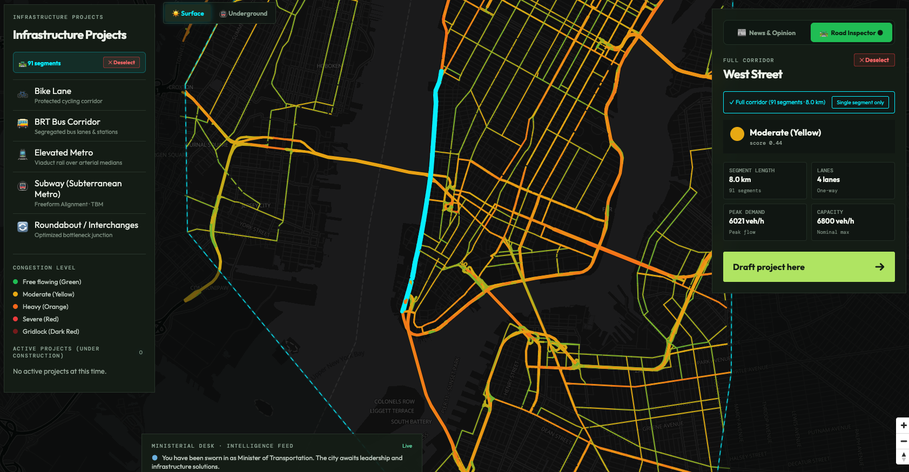
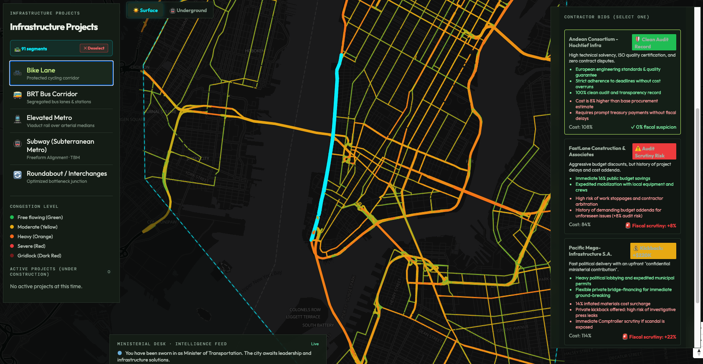
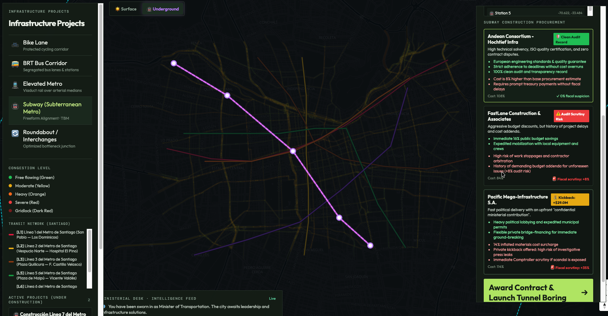
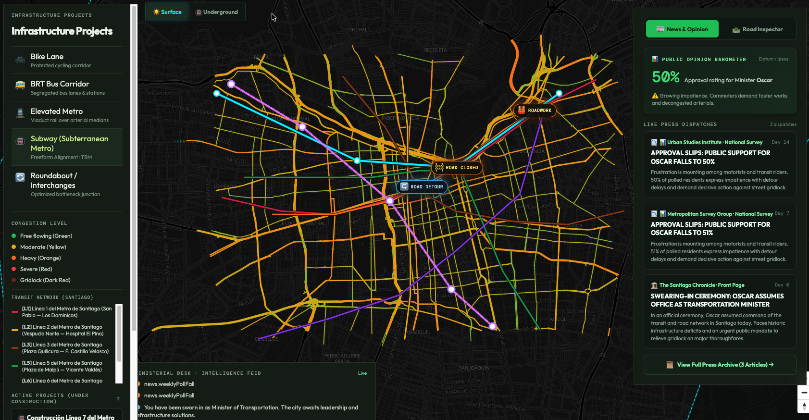

# Fix My Traffic 🚦 🏛️

> **The urban mobility and municipal political simulation game.**  
> Assume command as Mayor and Chief of Transportation. Modernize transit corridors, build underground subway networks, balance budgets, and survive political scrutiny before the next election.

---

## 📸 Game Showcase & Core Mechanics

### 1. Real-World Traffic Flow & Corridor Inspection
*Diagnose congestion bottlenecks across real OpenStreetMap highway networks. Click any street or double-click continuous avenues to inspect lane capacities, vehicle throughput, and travel delays in real time.*



---

### 2. Infrastructure Works & Contractor Tenders
*Expand transportation capacity with Dedicated BRT Busways, Protected Bike Lanes, Extra Vehicle Lanes, Tolls, and Road Paving. Review competing contractor bids—balancing budget, speed, and under-the-table kickbacks.*



---

### 3. Freeform Underground Metro Expansion (TBM)
*Switch to Subterranean Mode to excavate deep underground metro tunnels. Drop stations directly across high-congestion districts; the Tunnel Boring Machine dynamically connects your stations to permanently relieve surface traffic.*



---

### 4. Municipal Politics, Approval & Corruption Trials
*Every decision impacts Citizen Approval, Commuter Satisfaction, and Fiscal Reserves. Beware of illicit contractor bribes—if Corruption Suspicion crosses 50%, anti-graft prosecutors will launch criminal inquiries and seek your impeachment.*



---

## 🌟 Key Features

- **Real Metropolitan Networks**: Curated playable datasets for **Lima**, **Buenos Aires**, **Santiago**, and **Ciudad de México**—complete with real street names, lane configurations, speed limits, and transit lines.
- **Global OSM City Importer**: Search and simulate **any city in the world** (New York, Madrid, Tokyo, Bogotá, São Paulo...) with dynamic road geometry and transit relations fetched on demand.
- **Dynamic Transit Layers**: Toggle seamlessly between surface streetcars/BRT and subterranean heavy-rail subway networks.
- **Deep Political Economy**:
  - 5-year municipal term clock (1,825 simulated days).
  - Public budget vs. personal bank accounts.
  - Contractor bidding with variable risk, delivery timelines, and bribery attempts.
  - 24/7 TV Breaking News network broadcasting emergency decrees, citizen strikes, and mayoral scandals.
- **Local-First & Cloud-Synced Architecture**:
  - Instant offline performance powered by IndexedDB.
  - Optional cloud synchronization with Supabase for shared community datasets.

---

## 🚀 Quickstart & Local Development

### Requirements
- Node.js `20.19+` or `22.12+`
- npm or pnpm

### Installation

```bash
# Clone the repository
git clone https://github.com/your-username/fix-my-traffic.git
cd fix-my-traffic

# Install dependencies
npm install

# Start local development server (runs on port 3000)
npm run dev -- --port 3000
```

Open [http://localhost:3000/](http://localhost:3000/) in your browser.

---

## 🧪 Verification & Testing

```bash
# Type check TypeScript
npm run typecheck

# Run unit and simulation tests
npm test

# Build production bundle
npm run build
```

---

## 🗺️ OpenStreetMap & Data Attribution

- Street geometries, highway tags, and transit relations © [OpenStreetMap](https://www.openstreetmap.org/copyright) contributors (ODbL 1.0).
- Built with React, TypeScript, Vite, MapLibre GL, and TailwindCSS.
